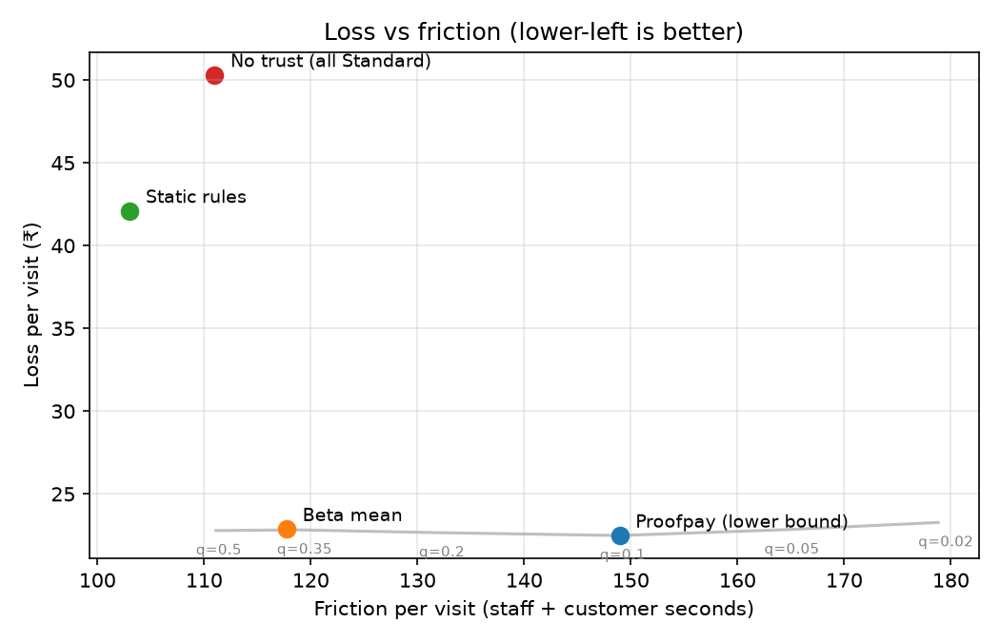

# Proofpay

**Pay for what the camera proved, at the friction your history earned.**

At checkout, PayPal authorizes the whole basket. Computer vision decides which items actually left with the customer. Proofpay captures only the verified lines, releases the rest, and refunds upheld "Not mine" disputes. A trust score learned from each payer's history sets how much is held, how strict the exit check is, and when capture happens without a human. The same engine gives an AI shopping agent a spending limit that grows as its purchases turn out correct.

**Live demo:** https://proofpay-6jk0.onrender.com (offline mode; Render's free plan sleeps when idle, so the first request can take about a minute).

> Status (2026-10-30): everything runs end to end against an offline PayPal stand-in. The live sandbox run is pending sandbox credentials.

## Run it

Offline mode runs with no PayPal keys, no model key and no GPU:

```bash
python -m venv .venv && .venv/Scripts/activate      # Windows; use bin/activate elsewhere
pip install -e ".[dev]"
cd web && npm ci && npm run build && cd ..
uvicorn proofpay.api:app --port 8000                # open http://localhost:8000
```

The UI labels every stand-in:
- **PayPal: offline stand-in** is `proofpay/paypal/fake.py`, an httpx transport that enforces the rules Proofpay relies on (amount = item total, capture ≤ authorization, refund ≤ capture, idempotent `PayPal-Request-Id`). It is not evidence of how the real sandbox behaves.
- **AI: template** is a deterministic fallback used when no `GEMINI_API_KEY` is set.
- **Vision: replay** replays recorded detection traces from `demo/scenarios/`.

To use the real sandbox:
1. Create a sandbox REST app plus buyer and merchant accounts at developer.paypal.com.
2. Copy `.env.example` to `.env` and fill in the keys.
3. Set `PROOFPAY_PAYPAL=sandbox`.
4. For webhooks, subscribe to the events in [docs/verified-facts.md](docs/verified-facts.md) with URL `<host>/api/webhooks/paypal`, and set `PAYPAL_WEBHOOK_ID`.

For development, run `npm run dev` in `web/` with `NEXT_PUBLIC_API_BASE=http://localhost:8000`.

## Architecture

```
 shelf cameras ──► vision engine (replay traces; pluggable VisionEngine)
                        │  line, p(taken), evidence
                        ▼
 Next.js (static) ──► FastAPI ──► trust engine (pure)  ◄── trust_events (SQLite)
   checkout / staff /    │            policy + hold                ▲
   trust / agent / sim   │                                         │
                         ├──► PayPal Orders v2: create (AUTHORIZE), authorize
                         ├──► PayPal Payments v2: capture verified, void, refund
                         ├──◄ PayPal webhooks (signature-verified) ────────┘
                         └──► Gemini: exit explainer, dispute triage, agent planner
```

**PayPal APIs used:**
- Orders v2: `POST /v2/checkout/orders` with intent `AUTHORIZE`; `POST /v2/checkout/orders/{id}/authorize`.
- Payments v2: `POST /v2/payments/authorizations/{id}/capture` (verified total, `final_capture`, unique `invoice_id`), `.../void`, `POST /v2/payments/captures/{id}/refund`.
- `POST /v1/notifications/verify-webhook-signature`.
- JS SDK v6 through `@paypal/react-paypal-js/sdk-v6`.
- Every mutating call sends a deterministic `PayPal-Request-Id`, so a retry can't double-capture or double-refund.

**AI components:**
1. Vision probabilities decide what is billable.
2. The exit-check explainer summarises evidence for staff.
3. Dispute triage recommends on "Not mine" claims.
4. The agent planner picks supplies from a catalog.

Staff make every decision. Recommendations are stored with the staff decision, and `/api/ai/agreement` reports the agreement rate.

**Agent client.** PayPal's [Agent Toolkit](https://github.com/paypal/agent-toolkit) exposes merchant-side tools (`create_order`, `get_order`, `pay_order`). The agent here buys, so it calls the same REST endpoints directly, and every payment passes `authorize_agent_spend` first.

**Currency.** INR isn't in PayPal's REST currency list. The store and the trust engine use rupees, and PayPal amounts are USD at a fixed demo rate (`DEMO_INR_PER_USD`, default 85).

**Deploy.** `Dockerfile` builds the web export and serves it from FastAPI. `render.yaml` defines one Render web service on the free plan (deployed as a Blueprint from the public repo URL, so redeploys are manual). SQLite lives in `/tmp`, so demo data resets on redeploy or restart. To switch the hosted demo to the sandbox, set the `PAYPAL_*` keys and `PROOFPAY_PAYPAL=sandbox` in the service's environment.

## The one rule

**Trust changes friction, never charges.** A line is billable only if vision probability `p ≥ 0.90` or a staff member confirmed it. Trust can lower the bar for *skipping the human* on lines that are already billable, within `[0.95, 0.99]`. It never makes an uncertain line chargeable. Trust uses only payment and verification history on this platform: no demographics, location or device fingerprints.

## Trust engine (`proofpay/trust/`)

Pure functions, no I/O. Every output carries an explanation: the events used, their weights, and the resulting parameters.

**Evidence.** Each subject (a PayPal `payer_id`, or an agent id) has a Beta(α, β) reputation.

| Event | Effect |
|---|---|
| `capture_verified` | α += mean over lines of f(p), with f(p) = clip((p − 0.5)/0.5, 0, 1) |
| `agent_purchase_ok` | α += 1 |
| `line_disputed_rejected` | β += 3 (footage shows the take) |
| `exit_mismatch` | β += 5 (staff found an untracked item) |
| `dispute_opened` / `chargeback` | β += 2 / 10 |
| `agent_purchase_returned` / `_overridden` | β += 1 / 2 |
| `line_disputed_upheld`, `refund` | recorded, not scored (an upheld dispute is the camera's error) |

**Decay.** Each event's weight is multiplied by 0.5^(age / 90 days).

**Prior.** A cohort Beta(α₀, β₀) fitted by method of moments (empirical Bayes), clamped to strength 2–6 and mean ≤ 0.8, so a new subject starts uncertain rather than trusted.

**Score.** Decisions use the 10th percentile of Beta(α, β), not the mean. Less history means a wider posterior, which means a lower score.

**Anti-gaming.**
- Positive evidence is capped at 3 per 7-day window.
- A basket above 3× the subject's median basket can't use Express.
- Subjects with fewer than 3 verified visits can't auto-capture more than ₹500.

**Policy choice.** For each basket, every policy's expected cost is computed and the cheapest allowed one wins:

```
cost = Σ_unchecked p·price                       (uncertain lines nobody checks)
     + (1 − score) · 0.3 · basket · (1 − catch)   (items hidden from the cameras)
     + Σ_auto (1 − p)(price + ₹50)               (auto-captured false positives)
     + ₹0.1/s · (staff_s + 2 · customer_s)        (friction)
```

| Policy | Auto-capture bar | Uncertain lines | Exit-check catch rate | Hold |
|---|---|---|---|---|
| Express | 0.99 → 0.95 as trust rises | released unbilled | 10% | verified lines |
| Standard | 0.99 | staff check | 50% | verified + uncertain |
| Strict | 0.99, nothing above ₹200 | staff check | 90% | basket + 15% |

The Strict buffer is authorized up front because PayPal caps over-capture at 115% or USD 75 more, whichever is less (see [docs/verified-facts.md](docs/verified-facts.md)).

**Agent limit.** `limit = ₹500 + (₹20,000 − ₹500) · max(0, (score − 0.35)/0.65)`. A request within the limit is allowed. Up to 3× the limit goes to the human for approval. Anything above that is denied.

All defaults, with the reasoning for each, are in [proofpay/trust/config.py](proofpay/trust/config.py).

## Evaluation (`proofpay/sim/`)

To reproduce every number and figure:

```bash
python -m proofpay.sim --seed 0
```

The simulated population is 500 shoppers × 30 visits:
- 300 honest
- 100 careless (forget items, dispute honestly)
- 60 opportunistic (occasional false "Not mine")
- 40 fraudsters (build trust on small baskets, then hide half of large ones)

**The vision error rates are assumptions, not measurements.** They're listed in [proofpay/sim/world.py](proofpay/sim/world.py). Every strategy sees the same pre-drawn world.



Results for seed 0 ([full table](docs/eval/results.md)):

| Strategy | Loss ₹/visit | Staff s/visit | Honest → Strict | Fraud cash-out loss ₹ |
|---|---|---|---|---|
| Proofpay (10th percentile) | **22.5** | 72.0 | 28.2% | **155,982** |
| Beta mean | 22.9 | 56.4 | 7.1% | 171,143 |
| Static rules | 42.1 | **49.0** | **0.6%** | 175,620 |
| No trust (all Standard) | 50.3 | 53.0 | 0.0% | 581,583 |

**What this shows:**
- Any learned trust roughly halves loss compared with static rules or no trust.
- It also cuts fraud cash-out loss to under a third of the no-trust level, because caught fraudsters move to Strict and stay there.

**Where Proofpay is worse:**
- At the default 10th-percentile score, it sends 28% of honest visits to Strict and costs about 15 more staff-seconds per visit than the Beta mean, for almost the same loss.
- The quantile sweep (grey line) shows loss is nearly flat across q = 0.02–0.5, while friction falls steadily. In this world the lower bound's caution mostly buys friction.
- Static rules have the least friction and the fewest false Strict visits, but nearly twice the loss.
- "Fraudsters caught" is 40/40 for every strategy, because a cash-out basket trips the value-at-risk check. The useful number is cash-out loss.

**Sensitivity to the concealment assumption.** The cost model assumes a dishonest shopper hides 30% of the basket. That assumption, together with a score that levels off near 0.88 under 90-day decay, makes Express rare for baskets above about ₹200. Across seeds 0 and 1, lowering the ratio keeps loss flat and cuts false Strict visits, at some cost in fraud loss:

| Concealment ratio | Loss ₹/visit (seed 0 / 1) | Honest → Strict | Fraud cash-out loss (seed 0) |
|---|---|---|---|
| 0.30 (default) | 22.5 / 23.8 | 28% | 155,982 |
| 0.20 | 22.5 / 23.6 | 15% | 160,594 |
| 0.15 | 22.7 / 23.6 | 10% | 166,022 |
| 0.10 | 22.7 / 23.5 | 5% | 171,585 |

The default stays at 0.3 until it is chosen deliberately. It is a product decision, not something to tune for a nicer chart.

## Repository layout

```
proofpay/trust/     trust engine (reputation, policy, config): pure, no I/O
proofpay/sim/       population simulator and baselines
proofpay/paypal/    REST client (sandbox only) and offline stand-in
proofpay/checkout.py  authorize -> exit check -> capture / void / refund
proofpay/agent.py   trust-gated purchasing agent
proofpay/ai.py      exit explainer and dispute triage (Gemini, template fallback)
proofpay/vision.py  VisionEngine interface and trace replay
proofpay/api.py     FastAPI app; also serves web/out
web/                Next.js app (static export), AG Grid tables
demo/               detection traces and the agent's supply catalog
docs/               verified PayPal/Devpost facts, eval outputs
```

Tests: `pytest` (trust engine, simulator, checkout against the stand-in, API).

## Licence

Apache-2.0. See [LICENSE](LICENSE).
