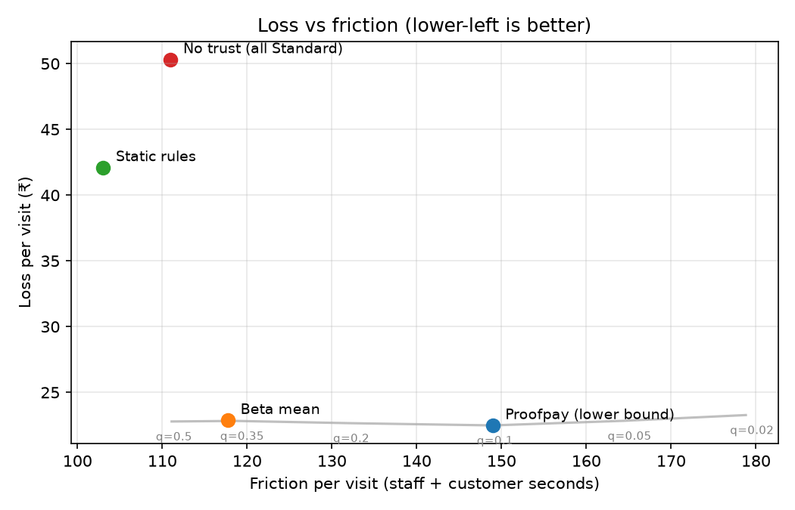

# Witnessed

**PayPal for in-person handovers: camera evidence becomes the tracking number that in-person sales never have.**

A shipped order has a tracking number. PayPal's Seller Protection asks for one ("an online and verifiable tracking number") as proof of delivery. An item handed over in person has nothing comparable: for in-person delivery PayPal asks sellers for "alternative evidence of delivery" instead ([Seller Protection](https://www.paypal.com/us/legalhub/paypal/seller-protection), quoted in [docs/verified-facts.md](docs/verified-facts.md)).

Witnessed makes that evidence and ties the money to it:

1. **Hold.** The buyer approves a PayPal order with intent `AUTHORIZE` for the whole basket.
2. **Witness.** Cameras give each item a probability that it was actually handed over. Only items at p ≥ 0.90, or confirmed by staff, can be charged.
3. **Capture what was witnessed.** Witnessed captures only those lines and releases the rest. The capture's `note_to_payer` links to a **handover evidence record**: per item, the camera events, the decision and its basis, the PayPal IDs, and a SHA-256 of the record.
4. **Keep holds alive.** The **Holds** timeline (Bryntum Scheduler) shows every open authorization against PayPal's honor period (3 days) and validity (29 days). For holds at risk, an AI picks reauthorize (allowed once, day 4–29), capture the verified lines, void, or wait, and Witnessed does it with PayPal.
5. **"Not mine."** A buyer can dispute a line; AI triage reads the evidence and recommends; staff decide; an upheld claim becomes a partial PayPal refund.

Supporting the above, a trust score learned from each payer's history sets how big the hold is and whether a human checks the handover. It never changes what is charged. The same engine gives an AI shopping agent a spending limit that grows as its purchases turn out correct.

**Live demo:** https://proofpay-6jk0.onrender.com (PayPal sandbox; Render's free plan sleeps when idle, so the first request can take about a minute). The repository and service keep their original name, Proofpay; the product was renamed to Witnessed on 2026-11-10.

**Is the evidence accepted by PayPal?** Untested. Witnessed produces the record and links it from the capture; no Seller Protection claim has been filed with it. In-person store sales qualify for Seller Protection only when paid by a PayPal goods-and-services QR code, which Witnessed does not use.

## Run it

Offline mode runs with no PayPal keys, no model key and no GPU:

```bash
python -m venv .venv && .venv/Scripts/activate      # Windows; use bin/activate elsewhere
pip install -e ".[dev]"
cd web && npm ci && npm run build && cd ..
uvicorn proofpay.api:app --port 8000                # open http://localhost:8000
```

The UI labels every stand-in:
- **PayPal: offline stand-in** is `proofpay/paypal/fake.py`, an httpx transport that enforces the rules Witnessed relies on (amount = item total, capture ≤ authorization, refund ≤ capture, idempotent `PayPal-Request-Id`). It is not evidence of how the real sandbox behaves.
- **AI: template** is a deterministic fallback used when no `GEMINI_API_KEY` is set.
- **Vision: replay** replays recorded detection traces from `demo/scenarios/`.

To use the real sandbox:
1. Create a sandbox REST app plus buyer and merchant accounts at developer.paypal.com.
2. Copy `.env.example` to `.env` and fill in the keys.
3. Set `PROOFPAY_PAYPAL=sandbox`.
4. For webhooks, subscribe to the events in [docs/verified-facts.md](docs/verified-facts.md) with URL `<host>/api/webhooks/paypal`, and set `PAYPAL_WEBHOOK_ID`.

For development, run `npm run dev` in `web/` with `NEXT_PUBLIC_API_BASE=http://localhost:8000`.

## Architecture

```
 shelf cameras ──► vision engine (replay traces; pluggable VisionEngine)
                        │  line, p(taken), evidence
                        ▼
 Next.js (static) ──► FastAPI ──► trust engine (pure)  ◄── trust_events (SQLite)
   checkout / staff /    │            policy + hold                ▲
   trust / agent / sim   │                                         │
                         ├──► PayPal Orders v2: create (AUTHORIZE), authorize
                         ├──► PayPal Payments v2: capture verified, void, refund
                         ├──◄ PayPal webhooks (signature-verified) ────────┘
                         └──► Gemini: exit explainer, dispute triage, agent planner
```

**PayPal APIs used:**
- Orders v2: `POST /v2/checkout/orders` with intent `AUTHORIZE`; `POST /v2/checkout/orders/{id}/authorize`.
- Payments v2: `POST /v2/payments/authorizations/{id}/capture` (verified total, `final_capture`, unique `invoice_id`), `.../void`, `POST /v2/payments/captures/{id}/refund`.
- `POST /v1/notifications/verify-webhook-signature`.
- JS SDK v6 through `@paypal/react-paypal-js/sdk-v6`.
- Every mutating call sends a deterministic `PayPal-Request-Id`, so a retry can't double-capture or double-refund.

**AI components:**
1. Vision probabilities decide what is billable.
2. The exit-check explainer summarises evidence for staff.
3. Dispute triage recommends on "Not mine" claims.
4. The agent planner picks supplies from a catalog.

Staff make every decision. Recommendations are stored with the staff decision, and `/api/ai/agreement` reports the agreement rate.

**Agent shopping with real products.** The agent turns a task into product searches (Gemini, or a template split without a key) and runs them against [Channel3](https://trychannel3.com)'s product search API (`POST /v1/search`), taking the cheapest in-stock USD offer for each. The purchase then goes through the trust guard and the same hold-then-capture flow as the store: PayPal authorizes the order, and Witnessed captures only when a person confirms the delivery, or voids the hold if it was sent back. Prices are real Channel3 offers; the payment is a PayPal sandbox payment to Witnessed's test merchant, and nothing is ordered from the retailer. Without `CHANNEL3_API_KEY` the agent falls back to `demo/catalog.json`.

**Agent client.** PayPal's [Agent Toolkit](https://github.com/paypal/agent-toolkit) exposes merchant-side tools (`create_order`, `get_order`, `pay_order`). The agent here buys, so it calls the same REST endpoints directly, and every payment passes `authorize_agent_spend` first.

**Currency.** INR isn't in PayPal's REST currency list. The store and the trust engine use rupees, and PayPal amounts are USD at a fixed demo rate (`DEMO_INR_PER_USD`, default 85).

**Deploy.** `Dockerfile` builds the web export and serves it from FastAPI. `render.yaml` defines one Render web service on the free plan (deployed as a Blueprint from the public repo URL, so redeploys are manual). SQLite lives in `/tmp`, so demo data resets on redeploy or restart. To switch the hosted demo to the sandbox, set the `PAYPAL_*` keys and `PROOFPAY_PAYPAL=sandbox` in the service's environment.

## Holds timeline (`proofpay/holds.py`, `web/app/holds/`)

A PayPal authorization is not forever. Its funds are guaranteed for a 3-day honor period, it can be captured for 29 days, and it can be reauthorized from day 4 to day 29. The docs say "multiple re-authorizations"; the sandbox answered a same-day attempt with `REAUTHORIZATION_TOO_SOON`, "only allowed once from Day 4 to Day 29", so Witnessed allows one ([verified-facts](docs/verified-facts.md)).

- The **Holds** page draws every authorization on a [Bryntum Scheduler](https://bryntum.com/products/scheduler/) timeline: one lane per order, with the honor period, a reauthorization's new honor period, the unguaranteed stretch and the day-29 expiry.
- Each open hold gets a risk level and a list of **allowed** actions computed from those rules: `capture_verified`, `reauthorize`, `void`, `wait`.
- "Ask AI to act" sends the hold's facts and the allowed list to the model (Gemini, or a labelled template without a key). An action outside the list is rejected. Witnessed then performs the choice with PayPal (`/v2/payments/authorizations/{id}/reauthorize`, `/capture` with only the verified lines, or `/void`) and records the decision and its reasoning.
- No real authorization can be back-dated, so the hosted demo seeds five **simulated** holds (offline stand-in, labelled everywhere) at ages 0.4 to 26.8 days. Real sandbox holds created on the Checkout page appear beside them.

Bryntum is a commercial library used here under its free trial (the npm `@bryntum/scheduler-trial` package). It is loaded as a prebuilt script from `web/public/bryntum/`, copied at build time by `web/scripts/copy-bryntum.mjs`, rather than bundled.

## Handover evidence (`GET /api/sessions/{id}/evidence`, `web/app/evidence/`)

For each visit: every item's camera probability and events, whether it was charged and on what basis (camera p ≥ 0.90, staff confirmed, found at exit, or why not), refunds, the PayPal order, authorization and capture IDs, the PayPal calls made, and a SHA-256 of the record. The capture's `note_to_payer` carries the record's URL, so the evidence travels with the PayPal transaction the way a tracking number does.

## SDKs (`sdk/`, generated with APIMatic)

`sdk/src/spec/openapi.json` is Witnessed's OpenAPI spec, exported from FastAPI. [APIMatic](https://www.apimatic.io/) generated typed clients from it:

- [`sdk/python`](sdk/python/README.md) (`WitnessedClient`), with an [API reference](sdk/python/api-reference.md)
- [`sdk/typescript`](sdk/typescript/README.md), with an [API reference](sdk/typescript/api-reference.md)

```python
from witnessed import WitnessedClient          # pip install ./sdk/python
with WitnessedClient() as c:                   # defaults to the hosted demo
    for h in c.list_holds()["holds"]:
        print(h["customer_id"], h["risk"], h["allowed"])
```

To regenerate: `cd sdk && apimatic sdk generate -l python -d python -f` (and `-l typescript`). APIMatic's hosted docs portal needs a paid plan, so the SDKs' generated references are the docs.

## The one rule

**Trust changes friction, never charges.** A line is billable only if vision probability `p ≥ 0.90` or a staff member confirmed it. Trust can lower the bar for *skipping the human* on lines that are already billable, within `[0.95, 0.99]`. It never makes an uncertain line chargeable. Trust uses only payment and verification history on this platform: no demographics, location or device fingerprints.

## Trust engine (`proofpay/trust/`)

Pure functions, no I/O. Every output carries an explanation: the events used, their weights, and the resulting parameters.

**Evidence.** Each subject (a PayPal `payer_id`, or an agent id) has a Beta(α, β) reputation.

| Event | Effect |
|---|---|
| `capture_verified` | α += mean over lines of f(p), with f(p) = clip((p − 0.5)/0.5, 0, 1) |
| `agent_purchase_ok` | α += 1 |
| `line_disputed_rejected` | β += 3 (footage shows the take) |
| `exit_mismatch` | β += 5 (staff found an untracked item) |
| `dispute_opened` / `chargeback` | β += 2 / 10 |
| `agent_purchase_returned` / `_overridden` | β += 1 / 2 |
| `line_disputed_upheld`, `refund` | recorded, not scored (an upheld dispute is the camera's error) |

**Decay.** Each event's weight is multiplied by 0.5^(age / 90 days).

**Prior.** A cohort Beta(α₀, β₀) fitted by method of moments (empirical Bayes), clamped to strength 2–6 and mean ≤ 0.8, so a new subject starts uncertain rather than trusted.

**Score.** Decisions use the 10th percentile of Beta(α, β), not the mean. Less history means a wider posterior, which means a lower score.

**Anti-gaming.**
- Positive evidence is capped at 3 per 7-day window.
- A basket above 3× the subject's median basket can't use Express.
- Subjects with fewer than 3 verified visits can't auto-capture more than ₹500.

**Policy choice.** For each basket, every policy's expected cost is computed and the cheapest allowed one wins:

```
cost = Σ_unchecked p·price                       (uncertain lines nobody checks)
     + (1 − score) · 0.3 · basket · (1 − catch)   (items hidden from the cameras)
     + Σ_auto (1 − p)(price + ₹50)               (auto-captured false positives)
     + ₹0.1/s · (staff_s + 2 · customer_s)        (friction)
```

| Policy | Auto-capture bar | Uncertain lines | Exit-check catch rate | Hold |
|---|---|---|---|---|
| Express | 0.99 → 0.95 as trust rises | released unbilled | 10% | verified lines |
| Standard | 0.99 | staff check | 50% | verified + uncertain |
| Strict | 0.99, nothing above ₹200 | staff check | 90% | basket + 15% |

The Strict buffer is authorized up front because PayPal caps over-capture at 115% or USD 75 more, whichever is less (see [docs/verified-facts.md](docs/verified-facts.md)).

**Agent limit.** `limit = ₹500 + (₹20,000 − ₹500) · max(0, (score − 0.35)/0.65)`. A request within the limit is allowed. Up to 3× the limit goes to the human for approval. Anything above that is denied.

All defaults, with the reasoning for each, are in [proofpay/trust/config.py](proofpay/trust/config.py).

## Evaluation (`proofpay/sim/`)

To reproduce every number and figure:

```bash
python -m proofpay.sim --seed 0
```

The simulated population is 500 shoppers × 30 visits:
- 300 honest
- 100 careless (forget items, dispute honestly)
- 60 opportunistic (occasional false "Not mine")
- 40 fraudsters (build trust on small baskets, then hide half of large ones)

**The vision error rates are assumptions, not measurements.** They're listed in [proofpay/sim/world.py](proofpay/sim/world.py). Every strategy sees the same pre-drawn world.



Results for seed 0 ([full table](docs/eval/results.md)):

| Strategy | Loss ₹/visit | Staff s/visit | Honest → Strict | Fraud cash-out loss ₹ |
|---|---|---|---|---|
| Witnessed (10th percentile) | **22.5** | 72.0 | 28.2% | **155,982** |
| Beta mean | 22.9 | 56.4 | 7.1% | 171,143 |
| Static rules | 42.1 | **49.0** | **0.6%** | 175,620 |
| No trust (all Standard) | 50.3 | 53.0 | 0.0% | 581,583 |

**What this shows:**
- Any learned trust roughly halves loss compared with static rules or no trust.
- It also cuts fraud cash-out loss to under a third of the no-trust level, because caught fraudsters move to Strict and stay there.

**Where Witnessed is worse:**
- At the default 10th-percentile score, it sends 28% of honest visits to Strict and costs about 15 more staff-seconds per visit than the Beta mean, for almost the same loss.
- The quantile sweep (grey line) shows loss is nearly flat across q = 0.02–0.5, while friction falls steadily. In this world the lower bound's caution mostly buys friction.
- Static rules have the least friction and the fewest false Strict visits, but nearly twice the loss.
- "Fraudsters caught" is 40/40 for every strategy, because a cash-out basket trips the value-at-risk check. The useful number is cash-out loss.

**Sensitivity to the concealment assumption.** The cost model assumes a dishonest shopper hides 30% of the basket. That assumption, together with a score that levels off near 0.88 under 90-day decay, makes Express rare for baskets above about ₹200. Across seeds 0 and 1, lowering the ratio keeps loss flat and cuts false Strict visits, at some cost in fraud loss:

| Concealment ratio | Loss ₹/visit (seed 0 / 1) | Honest → Strict | Fraud cash-out loss (seed 0) |
|---|---|---|---|
| 0.30 (default) | 22.5 / 23.8 | 28% | 155,982 |
| 0.20 | 22.5 / 23.6 | 15% | 160,594 |
| 0.15 | 22.7 / 23.6 | 10% | 166,022 |
| 0.10 | 22.7 / 23.5 | 5% | 171,585 |

The default stays at 0.3 until it is chosen deliberately. It is a product decision, not something to tune for a nicer chart.

## Built during the hackathon

Witnessed (first named Proofpay) is a new project. No code predates the submission period, and the history starts at `ed88ea0` (2026-10-30):

| Commits | What |
|---|---|
| `ed88ea0` | Trust engine, unit tests, population simulator |
| `27b26a5` | PayPal client and offline stand-in, checkout service, API, vision replay, AI advisor, agent guard |
| `3cdc254` onward | Web app, Render deploy, docs |

Third-party code is limited to the dependencies in `pyproject.toml` and `web/package.json`.

The submission text is in [docs/devpost.md](docs/devpost.md), and the demo video script is in [docs/video-script.md](docs/video-script.md).

## Repository layout

```
proofpay/trust/     trust engine (reputation, policy, config): pure, no I/O
proofpay/sim/       population simulator and baselines
proofpay/paypal/    REST client (sandbox only) and offline stand-in
proofpay/checkout.py  authorize -> exit check -> capture / void / refund
proofpay/agent.py   trust-gated purchasing agent (hold, capture on confirmed delivery)
proofpay/catalog.py Channel3 product search for the agent
proofpay/holds.py   authorization timeline rules and AI hold rescue
sdk/                OpenAPI spec and APIMatic-generated Python/TypeScript SDKs
proofpay/ai.py      exit explainer and dispute triage (Gemini, template fallback)
proofpay/vision.py  VisionEngine interface and trace replay
proofpay/api.py     FastAPI app; also serves web/out
web/                Next.js app (static export), AG Grid tables
demo/               detection traces and the agent's supply catalog
docs/               verified PayPal/Devpost facts, eval outputs
```

Tests: `pytest` (trust engine, simulator, checkout against the stand-in, API).

## Licence

Apache-2.0. See [LICENSE](LICENSE).
